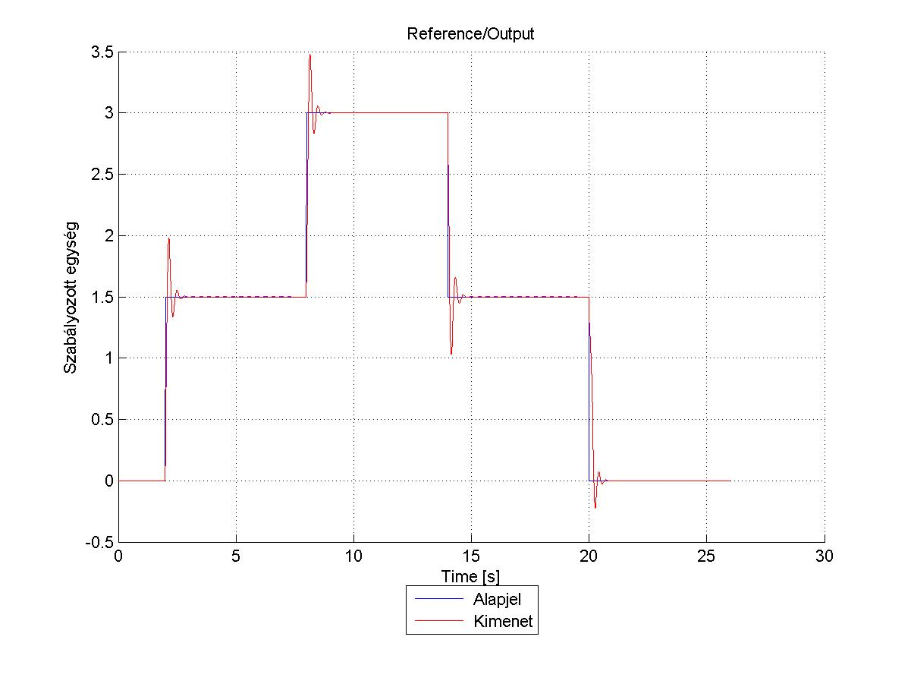
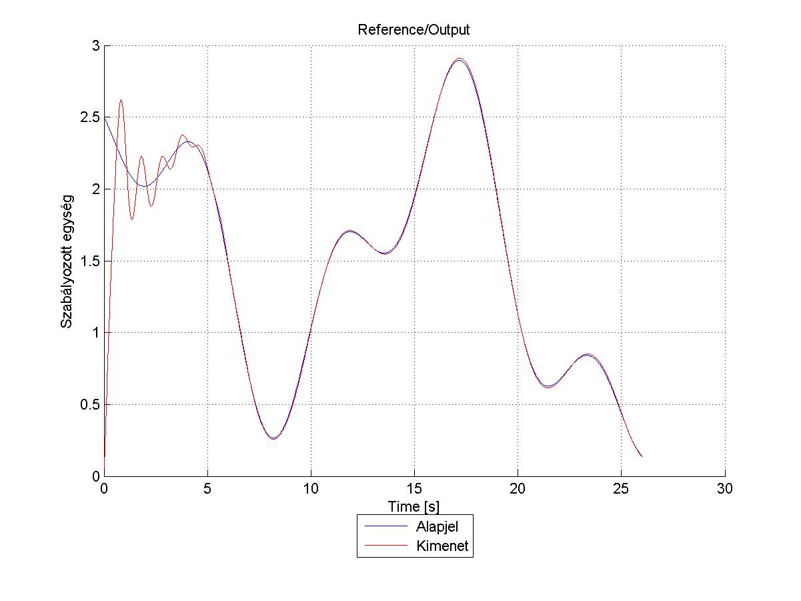
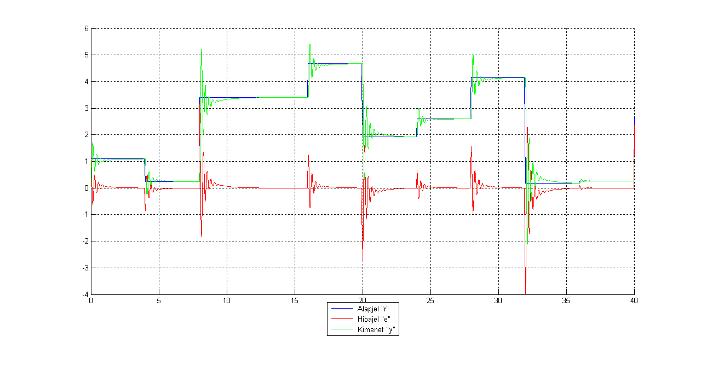
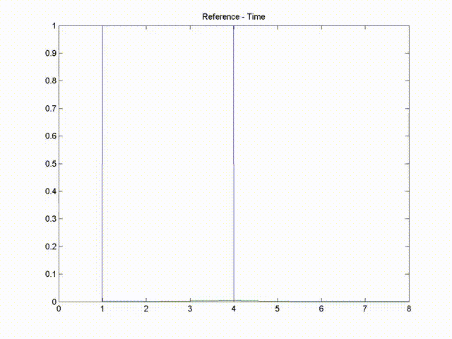

# Neural Networks Based Adaptive Control of Nonlinear Multivariable Systems

Completed as my BSc thesis.

[Read the thesis](docs/Diplomamunka.pdf)

Visualization of the operation of different systems that were trained and experimented with during the thesis implementation.

'PID-<N>' where N means the version number of the model.

**PID-8 model with online behavior:**

**PID-9 model (offline) pre-trained:**

Video displaying the step function response as the PID parameters are learned by the system:

